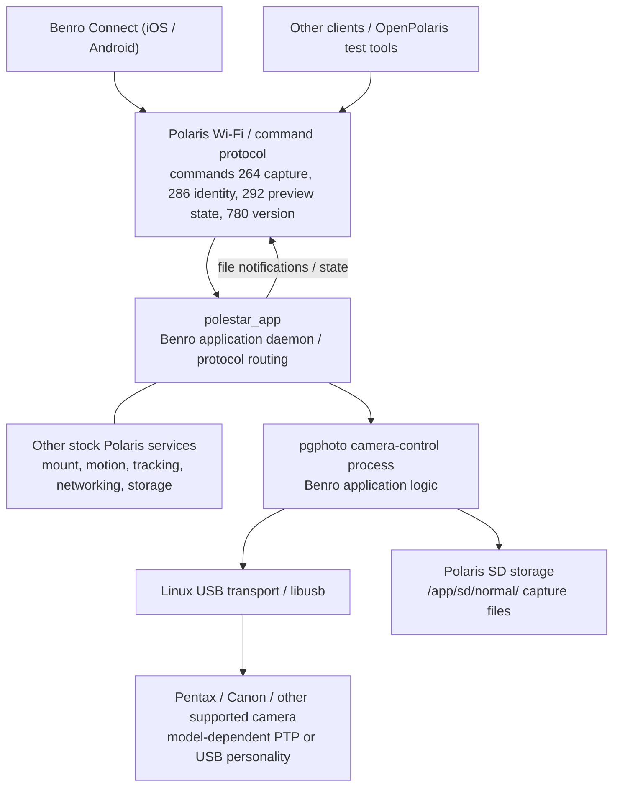
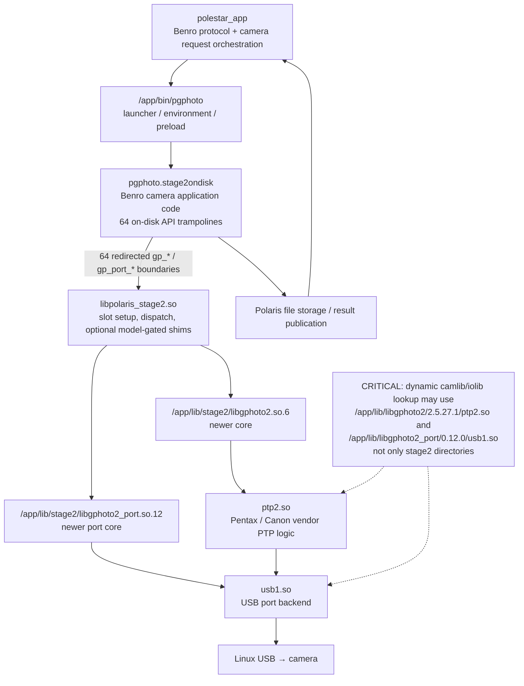
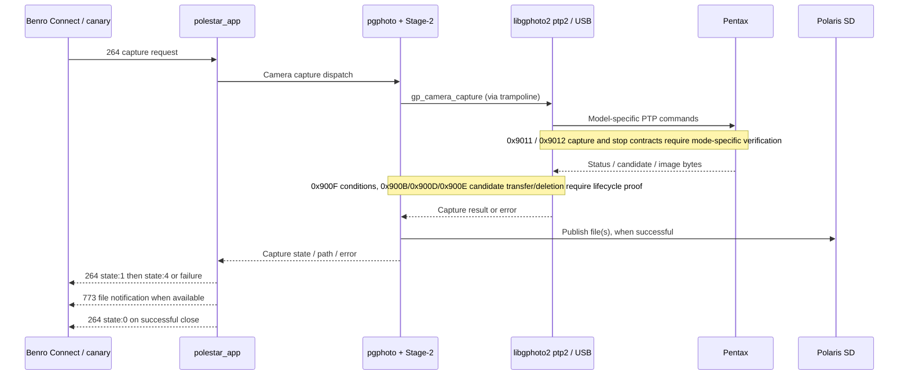
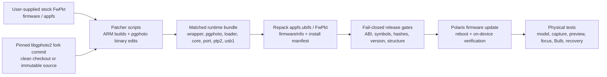

# Benro Polaris Firmware Patcher

Patch the Benro Polaris camera firmware to control cameras its stock libgphoto2
can't. It rebuilds the Polaris' camera-control driver (`libgphoto2` / the `ptp2`
PTP camlib) from a **newer libgphoto2 release**, applies a few surgical edits to
the `pgphoto` control binary, and repackages everything into a **flashable
firmware image**.

For the current protected baseline, open bugs and authoritative evidence entry
points, start with [docs/CURRENT-STATE.md](docs/CURRENT-STATE.md).

It was created to fix the **Canon EOS R5 Mark II** on the Polaris, where three
things were broken on stock firmware (libgphoto2 2.5.27, ~2021):

1. **Image capture hung forever** — fixed by rebuilding the driver from
   libgphoto2 **2.5.34** (correct Canon object-download/event handling).
2. **A cold connect took ~3 minutes** before live view / shutter would start —
   fixed by neutralising a USB-reset re-enumeration storm (`resetUsb`) and by
   skipping the eager full-card PTP file scan `cameraInit` runs at connect.
3. Reboot-hang after flashing — avoided by preserving the UBIFS `space_fixup`
   flag on repack.

Result on a real R5 Mark II (flash-verified end-to-end): **immediate detection,
settings that stick, live view, no "no card" warning, and capture that downloads
both JPEG and RAW.** See [docs/TESTED.md](docs/TESTED.md).

## Polaris Astro plate-solving

The Astro work is a separate, additive feature branch. Its current architecture,
what is actually wired, evidence, safety boundaries and remaining qualification
work are documented in the [Astro plate-solving README](docs/ASTRO-README.md).

Short version: the native ARM bundle and guarded host pipeline build
successfully, but the complete physical capture-to-tracking journey is not yet
qualified. Astrometry.net remains the default solver; the native-C solver is a
research alternative. The Astro branch defaults to **build and do not deploy**.

## Architecture map — agent onboarding (October 2026)

> **Scope and confidence.** This is the documented architecture of the camera-control path and firmware packaging, not a claim that every runtime edge has been independently traced on the device. The active installed/qualified build and its exceptions are recorded in [CURRENT-STATE](docs/CURRENT-STATE.md) and [RELEASE-VERSION-STATE](docs/RELEASE-VERSION-STATE.md). **Never substitute GitHub HEAD for the installed libgphoto2 commit.** For detailed binary/ABI evidence see [HOW-IT-WORKS](docs/HOW-IT-WORKS.md); for source selection and upgrade gates see [canonical-pentax-source](docs/canonical-pentax-source.md).

### 1. System context: phone, Polaris, camera and files



The phone does **not** call libgphoto2 directly. `polestar_app` mediates the Benro command protocol and delegates camera work to `pgphoto`. Camera images are eventually surfaced through Polaris storage and the application protocol. This diagram intentionally omits internal motion-controller details not verified by this camera-stack audit.

### 2. The full-mode camera runtime (default patch)



**Why the trampoline exists:** Benro compiled its older libgphoto2 core into `pgphoto`. Merely replacing `ptp2.so` would leave old core behaviour in place. The patcher modifies **64 public API entry points on disk**, redirecting calls through loader-populated slots to the newer core and port. The loader does not rewrite executable text at runtime. The patched binary still owns Benro-specific control logic and non-trampolined functions. The patched core maintains Benro's extended `Camera` structure ABI (the documented 4,140-byte allocation). See [HOW-IT-WORKS](docs/HOW-IT-WORKS.md) for slot layout, ABI checks and crash checkpoints.

**The alternative `--ptp2-only` mode is architecturally different:** it retains the older compiled-in core and applies only the targeted reliability patch plus replacement camlib/iolib. **Never assume a full-mode defect reproduces in ptp2-only mode or vice versa.** Optional Stage-2 shims are gated by feature flags and camera model; Canon R5 II shims are not automatically Pentax shims.

### 3. Capture request, completion and failure boundaries



The **observed** .68 K-3 III three-shot short-RAW protocol is `264 state:1 → 264 state:4 → 773 file → 264 state:0`, three distinct DNGs with stable process IDs. This proves that **one** app-facing capture scenario works, **not** the precise internal PTP sequence or all capture modes. A later 10-second timed Bulb with noise reduction succeeded, followed by a Manual-dial `264 state:-1005` failure with no new file; a separate session wedge left USB physically present. See [stability evidence](docs/evidence/o-v17c-stability-20261019/SUMMARY.md), [#172](https://github.com/ian-morgan99/benro-polaris-firmware-patcher/issues/172) and [#182](https://github.com/ian-morgan99/benro-polaris-firmware-patcher/issues/182). **Do not interpret USB enumeration as a healthy PTP session.**

### 4. Firmware production and installation (separate from runtime)



The image is a **matched compatibility unit**, not a collection of independently swappable `.so` files. A successful host-side `gphoto2` test does not establish the packaged `pgphoto` path. Keep stock firmware for recovery; follow [FWPKT provenance](docs/FWPKT-PROVENANCE-CONTRACT.md), [upgrade process](docs/LIBGPHOTO2-UPGRADE-PROCESS.md) and [current release state](docs/RELEASE-VERSION-STATE.md). A displayed version number alone is insufficient: correlate build ID, exact source commits, firmware ZIP hash, installed manifest and **actual mapped libraries**.

### 5. Responsibility / debugging cheat sheet

| Boundary | Owns or controls | Typical evidence and first place to investigate |
| --- | --- | --- |
| Benro Connect / protocol | User requests, mode and UI state | Client trace; `264`, `286`, `292`, `773`, `780` responses |
| `polestar_app` | Benro protocol routing and camera workflow admission | Mlog, command handler, app PID/thread health; [Benro #224](https://github.com/ian-morgan99/benro-polaris-firmware-patcher/issues/224) |
| `pgphoto.stage2ondisk` | Camera request dispatch, Benro-specific policies and errors | Process logs, command `264` mapping, `-1005`, timeout, daemon ownership |
| `libpolaris_stage2.so` | ABI trampoline, loader, feature/model-gated shims | `[stage2]` checkpoints, slot resolution, `/proc/PID/maps`, env flags |
| libgphoto2 core / `ptp2.so` | Camera controls, vendor PTP, capture/candidate/session lifecycle | Exact embedded commit, PTP opcodes and return values; [libgphoto2 #113](https://github.com/ian-morgan99/libgphoto2/issues/113) |
| Port core / `usb1.so` / kernel | USB transfer and device interface | `/proc/PID/maps`, sysfs enumeration, port errors, USB traces |
| Camera body | Actual firmware state, dial mode, shutter, NR, Pixel Shift | Per-model evidence, physical observation; [Benro #222](https://github.com/ian-morgan99/benro-polaris-firmware-patcher/issues/222) |
| Firmware build / installer | Immutable source identity and complete packaged stack | `install-manifest.json`, firmwareInfo hashes, device reboot and installed-file verification |

### 6. First-hour checklist for another agent

1. Read [CURRENT-STATE](docs/CURRENT-STATE.md), [RELEASE-VERSION-STATE](docs/RELEASE-VERSION-STATE.md), this diagram, and [HOW-IT-WORKS](docs/HOW-IT-WORKS.md). Determine **which version is installed**, not just the latest reserved version.
2. Pin the exact patcher and libgphoto2 SHAs. Identify whether the tested device uses **full mode** or **ptp2-only**. Read `/proc/<pgphoto-pid>/maps` and `/proc/<pgphoto-pid>/exe` before attributing behaviour to a particular `ptp2.so`; verify hashes of the loaded files. Do not restart the daemon merely to gather evidence.
3. Reproduce at the **lowest appropriate layer**: direct libgphoto2, packaged pgphoto, then Benro Connect. A success in one layer does not qualify the next.
4. For capture failures record the first divergent transition: client `264`, pgphoto admission, PTP response, candidate discovery, transfer, file publication, `773`, completion and next-shot readiness. Record camera dial, model, firmware, NR, Pixel Shift, RAW/JPEG, live view, timeout and USB/session health.
5. Compare independently against authorized [PrivateResearch](https://github.com/ian-morgan99/PrivateResearch) (Pentax firmware, Image Transmitter 2, Benro firmware and app evidence). **Do not copy proprietary decompiled code into public issues.** Distinguish direct observation, source assumption and hypothesis.
6. Keep work in [master Pentax research backlog](https://github.com/ian-morgan99/libgphoto2/issues/113) and [Benro convergence programme #149](https://github.com/ian-morgan99/benro-polaris-firmware-patcher/issues/149). The active end-to-end trace is [#224](https://github.com/ian-morgan99/benro-polaris-firmware-patcher/issues/224). Report source-inspected, deterministic-tested and hardware-verified evidence **separately**.

---

> **Historical regression protection:** [Pentax capability-retention matrix](docs/PENTAX-CAPABILITY-RETENTION.md) records previously demonstrated RAW+JPEG, Preview, session recovery and Bulb behaviours, current evidence gaps, and mandatory release contracts. Historical PASS does not mean current PASS.

## Pentax support — engineering history, verified progress and remaining work

This project now includes substantial **Pentax support work**, particularly for the **K-3 Mark III**, **K-1 Mark II** and **K-01**, alongside its original Canon R5 Mark II support. The Pentax work spans the [libgphoto2 fork](https://github.com/ian-morgan99/libgphoto2), Polaris Stage-2 integration, capture/transfer lifecycle, focus, live view, Bulb exposure, firmware build provenance and hardware qualification. **Do not interpret the original R5 II-only disclaimer below as an up-to-date Pentax test matrix**; the evidence and qualifications in this section are more recent and model-specific.

### What has been built and investigated

| Workstream | Engineering scope and current interpretation |
| --- | --- |
| Pentax PTP protocol | Vendor commands including `0x900F` GetAllConditions, `0x9011` InitiateCapture, `0x9012` TerminateCapture, `0x900B` candidate info, `0x900D` file data, `0x900E` candidate deletion. Their exact parameter, error and abnormal-stop contracts remain under independent comparison with camera/IT2 evidence. |
| Capture and file transfer | Candidate discovery, RAW and JPEG selection, transfer, publication, deletion, stale-candidate recovery and next-shot admission. A successful file notification does not itself prove every error path or exactly-once publication. |
| Bulb and exposure modes | Camera-timed versus held/untimed Bulb, requested duration, long exposure, stop/abort safety and manual-dial transition. K-3 III timed Bulb has a recorded physical success, but Manual following Bulb still fails in one reproduced scenario. |
| Live view and focus | Live-view mode/preview restoration, focus dispatch and session interaction. The K-3 III and K-1 II use different Pentax focus command families; live-view crash and corrupted-preview reports remain model-specific investigations. |
| Controls | K-3 III Custom Image controls and white-balance colour temperature; scalar property descriptors, writable/read-only handling, and fresh-process readback. The .68 physical qualification verified colour-temperature behaviour and controlled blast radius. |
| Integration | Benro Connect / `polestar_app` / `pgphoto` / Stage-2 / libgphoto2 / USB. Full-mode and ptp2-only paths differ; the exact running core, port, camlib and iolib must be proven from process maps before blaming a layer. |
| Firmware and provenance | Version registry, source-commit binding, full image manifest, installed-file hashes, reboot confirmation, rollback policy and physical acceptance gates. A build being green is not equivalent to camera hardware qualification. |
| Regression testing | Deterministic simulation and physical scenarios covering RAW-only, RAW+JPEG, short/long, NR and Pixel Shift settings, with three repeats per scenario where appropriate. The complete matrix is **not** yet passed. |

### Verified K-3 III baseline and important limitations

The **19 October 2026 physically qualified firmware .68** (`6.0.0.54.68`, candidate `o-v17c-colortemp-formless`) is documented with patcher commit `36d72ae` and libgphoto2 commit `8e06d39ae`, a matched ten-file installed manifest, actual reboot, and working colour-temperature `0xd018` get/set/readback. The six previously working Custom Image controls continued to read and round-trip; empty-enumeration controls remained withheld. See [physical qualification](docs/evidence/o-v17c-physical-20261019/SUMMARY.md), [release state](docs/RELEASE-VERSION-STATE.md) and [current state](docs/CURRENT-STATE.md).

A separate [three-shot stability run](docs/evidence/o-v17c-stability-20261019/SUMMARY.md) produced **three distinct DNG files** (`SP_0357`–`SP_0359`) with app-facing lifecycle `[1,4,0]`, unchanged `polestar_app` and `pgphoto` PIDs, no observed USB loss, and stable file-descriptor counts. **Scope:** K-3 III, RAW, short exposure, noise reduction off, Pixel Shift off. This is **not** a claim of universal capture stability.

After that run, a **10-second Bulb exposure with noise reduction on succeeded** (`SP_0360.dng`), but the subsequent **Manual-dial capture failed** with protocol `264 state:-1005` and no new file ([#172](https://github.com/ian-morgan99/benro-polaris-firmware-patcher/issues/172)). A separate PTP session wedge was observed despite continued USB enumeration ([#182](https://github.com/ian-morgan99/benro-polaris-firmware-patcher/issues/182)). These failures remain open. Firmware `.69` appears in the version/commit registry; **a reserved or built version is not evidence that .69 has been installed or physically qualified**.

### Model-specific scope

| Camera | Evidence / engineering distinction | Do not assume |
| --- | --- | --- |
| **Pentax K-3 III** | Main physically tested body, USB `25fb:0189`; newer focus command family `0x9017`, camera controls and .68 capture/Bulb evidence | That timed Bulb success proves held Bulb, Manual transition, preview→capture or RAW+JPEG |
| **Pentax K-1 II** | Different focus family `0x9016`; prior reports include aperture-order mismatch and lower-half preview corruption | That K-3 III property fixes, focus or preview behaviour automatically generalise |
| **Pentax K-01** | Private model-sweep research distinguishes `25fb:0130` USB-SCSI from `25fb:0131` generic PTP/MTP personality | That a PTP path covers both USB personalities |

### Where agents should work

**Authoritative execution programme:** [Benro #149](https://github.com/ian-morgan99/benro-polaris-firmware-patcher/issues/149). **Research index:** [libgphoto2 #113](https://github.com/ian-morgan99/libgphoto2/issues/113) (twelve investigation avenues; *backlog captured is not research completed*). **Current end-to-end architecture and ownership audit:** [Benro #224](https://github.com/ian-morgan99/benro-polaris-firmware-patcher/issues/224).

| Work to pick up | Existing issue(s) |
| --- | --- |
| Independently validate Pentax capture/stop and conditions contracts | [libgphoto2 #112](https://github.com/ian-morgan99/libgphoto2/issues/112), [#114](https://github.com/ian-morgan99/libgphoto2/issues/114) |
| Compare authorized private Pentax firmware / Image Transmitter 2 evidence | [libgphoto2 #116](https://github.com/ian-morgan99/libgphoto2/issues/116) |
| Prove transfer, file publication, deletion and next-shot ownership | [libgphoto2 #115](https://github.com/ian-morgan99/libgphoto2/issues/115), [Benro #145](https://github.com/ian-morgan99/benro-polaris-firmware-patcher/issues/145) |
| Reconcile installed runtime and command ownership | [Benro #224](https://github.com/ian-morgan99/benro-polaris-firmware-patcher/issues/224) |
| Investigate live view, focus, USB and session recovery | [Benro #146](https://github.com/ian-morgan99/benro-polaris-firmware-patcher/issues/146), [#147](https://github.com/ian-morgan99/benro-polaris-firmware-patcher/issues/147), [#172](https://github.com/ian-morgan99/benro-polaris-firmware-patcher/issues/172), [#182](https://github.com/ian-morgan99/benro-polaris-firmware-patcher/issues/182) |
| Verify per-model capabilities and historical build differences | [libgphoto2 #117](https://github.com/ian-morgan99/libgphoto2/issues/117), [Benro #223](https://github.com/ian-morgan99/benro-polaris-firmware-patcher/issues/223) |
| Implement deterministic regression and complete physical qualification | [libgphoto2 #111](https://github.com/ian-morgan99/libgphoto2/issues/111), [Benro #180](https://github.com/ian-morgan99/benro-polaris-firmware-patcher/issues/180), [#222](https://github.com/ian-morgan99/benro-polaris-firmware-patcher/issues/222) |

For implementation, begin with the [architecture diagrams and debugging checklist above](#architecture-map--agent-onboarding-october-2026), [canonical source rules](docs/canonical-pentax-source.md), and the **exact installed commit**. Evidence from the private research repository may inform findings but proprietary firmware/app decompilation must not be copied into public issues. For each proposed fix, state the failure at the first proven layer, smallest justified change, deterministic tests, hardware requirements, regression risk and rollback path.

---

## Two modes (full is the default)

| Mode | What it swaps | Flag |
|---|---|---|
| **Full libgphoto2** — **DEFAULT** | The **whole** 2.5.34 stack: **core + port + ptp2 camlib + usb1 iolib**. `pgphoto`'s compiled-in 2.5.27 core is bypassed by an on-disk *trampoline* into the fresh core. **This is the mode verified end-to-end on the R5 Mark II** (cold boot, capture, live view). | *(none)* |
| **ptp2-only** — conservative fallback | Keeps `pgphoto`'s compiled-in 2.5.27 **core**, swaps only the **ptp2 camlib + usb1 iolib** and applies a 14-byte `pgphoto` patch. Smaller change; use it if the full swap misbehaves on your setup. | `--ptp2-only` / `-Ptp2Only` |

Both modes are **reversible** by re-flashing your stock `FwPkt`. Full mode also
writes a `stage2-ondisk/` bundle so you can **test on-device before flashing**
(install/revert scripts; see [docs/HOW-IT-WORKS.md](docs/HOW-IT-WORKS.md)).

---

## ⚠️ READ THIS FIRST — DISCLAIMERS

> **USE AT YOUR OWN RISK. NO WARRANTY. THIS IS NOT A BENRO PRODUCT.**
>
> - **Only tested against Benro Polaris firmware `FwVer 4.0.0.32`** with a
>   **Canon EOS R5 Mark II**. The tool refuses to patch if it can't find the
>   exact code patterns it expects, but "it ran" is not "it's safe for you."
> - **I only own a Canon R5 Mark II.** Applying this may **change or break
>   support for other camera models.** It has not been tested with any other
>   camera. If you use a different camera, you are the first tester.
> - Firmware flashing can go wrong. While the Polaris' SD-card update is
>   performed by U-Boot (which this tool does **not** touch — see
>   [docs/HOW-IT-WORKS.md](docs/HOW-IT-WORKS.md) for why a bad SD image is
>   normally recoverable by re-flashing), **no one can promise your specific
>   unit won't be affected. Proceed only if you accept the risk of bricking.**
> - **Always keep your original, unmodified `FwPkt` as the factory-restore
>   image.** Re-flashing it returns you to stock.
> - This project ships **no firmware**. You supply your own stock `FwPkt`
>   (see *Obtaining the stock firmware*). It also ships no libgphoto2 binaries —
>   they are built from source at run time.
> - Not affiliated with or endorsed by Benro, Snoppa, Canon, or the gphoto
>   project.

If any of the above is unacceptable to you, **do not use this tool.**

---

## What it actually changes

### Full mode (default) — hardware-verified end-to-end

Inside the firmware's `appfs`, full mode:

1. Replaces **`/app/bin/pgphoto`** with a tiny 9-line `sh` **wrapper** (no logging)
   that sets `CAMLIBS`/`IOLIBS`/`LD_LIBRARY_PATH`, `LD_PRELOAD`s the loader, turns
   the two runtime shims on, and `exec`s the trampolined binary.
2. Adds **`/app/lib/stage2/`** — a self-contained new stack the wrapper runs:
   - `libgphoto2.so.6` + `libgphoto2_port.so.12` — the fresh **2.5.34 core + port**;
   - `libgphoto2/2.5.34/ptp2.so` + `libgphoto2_port/0.12.2/usb1.so` — camlib + iolib;
   - `libpolaris_stage2.so` — the **loader** that redirects the 64 libgphoto2 API
     entry points `pgphoto` calls into the fresh core (an **on-disk trampoline**,
     no runtime code patching). It also carries three small env-gated **shims**
     (below);
   - `pgphoto.stage2ondisk` — the user's own `pgphoto`, reliability-patched
     (the same 14 bytes below) **and** on-disk-trampolined (byte-count-identical
     to stock; only ~719 bytes inside `.text` differ).
3. Replaces the **stock `ptp2.so` and `usb1.so`** (`/app/lib/libgphoto2/2.5.27.1/
   ptp2.so` and `/app/lib/libgphoto2_port/0.12.0/usb1.so`) with the same fresh
   2.5.34 builds. The swapped core dlopens its camlib/iolib from **these stock
   on-disk paths** at runtime — not from the `CAMLIBS` the wrapper exports — so the
   fresh driver must live there too, not only under `stage2/`.

The **loader's three R5 II-only shims** (no firmware code) are enabled by the
wrapper but also require the camera ability model to be exactly the corrected or
upstream-typo spelling of Canon EOS R5 Mark II. Unknown models, Pentax cameras,
and all other cameras bypass them:

- **Storage shim** (`STAGE2_STORAGE_SHIM=1`, on): writes the Benro `_Camera`
  storage-type field so the app shows a memory card and raises **no "no card"
  warning**.
- **Config shims** (`STAGE2_TETHER_CAPTURE=1`, on): a `gp_camera_set_config`
  tree-walk plus a `gp_camera_set_single_config` hook that force Canon's
  `capturetarget` to **"Internal RAM"** (tethered capture). The Polaris drives
  configs via `set_single_config`, so that hook is the one that fires.

The model check is deliberately fail-closed: inability to read the public
camera abilities record disables every compatibility write/rewrite.

**Why tethered capture:** through the fresh 2.5.34 core, Canon's card-mode
post-capture `ObjectAddedEx` event is not delivered, so a card-target shot never
signals "file ready" and the download hangs. Internal-RAM capture uses the
`ObjectTransfer` path, which **does** fire — so the shot completes and both the
**JPEG and the RAW** download to the Polaris. See
[docs/HOW-IT-WORKS.md](docs/HOW-IT-WORKS.md).

Every other `appfs` file — all other iolibs (`disk`/`serial`/`ptpip`/…), the
kernel, `rootfs.ubifs`, gimbal blobs, U-Boot env — is **byte-for-byte unchanged**.

### ptp2-only mode (`--ptp2-only`)

The conservative fallback changes up to **three** files in place:

1. **`/app/lib/libgphoto2/2.5.27.1/ptp2.so`** → freshly cross-compiled ptp2 camlib.
2. **`/app/lib/libgphoto2_port/0.12.0/usb1.so`** → freshly cross-compiled usb1
   iolib (skip with `--no-usb1` / `-NoUsb1`).
3. **`/app/bin/pgphoto`** → **14 bytes** of edits: 3 dispatch gates (load the new
   camlib instead of the compiled-in 2.5.27 copy), `resetUsb → return 0`, and
   skip the eager `ARG_LIST_FILES` full-card scan.

### Common to both modes

All patch sites are **discovered from `pgphoto`'s own symbol table** (the tool
refuses to run if it can't find/verify exactly what it expects), the rebuilt
libraries pass full ABI/glibc/symbol/`DT_NEEDED` verification, and `firmwareInfo`
is regenerated so the device's own MD5 check passes. The pgphoto reliability edits
(`resetUsb` + skip `ARG_LIST_FILES`) are present in **both** modes — in full mode
they live in the trampolined base binary.

> **Why the camlib historically needed 3 `pgphoto` gates:** Benro compiled the
> `ptp2` camlib *statically* into `pgphoto` and short-circuits its dispatch, so the
> on-disk `ptp2.so` is a dead filename marker in stock. ptp2-only mode re-routes
> those gates; **full mode** sidesteps the whole static core by trampolining every
> boundary call into the fresh 2.5.34 core. See
> [docs/HOW-IT-WORKS.md](docs/HOW-IT-WORKS.md).

See [docs/HOW-IT-WORKS.md](docs/HOW-IT-WORKS.md) for the full technical story
and [docs/TESTED.md](docs/TESTED.md) for exactly what was verified.
For patcher build-time gates, see [docs/patcher-gates.md](docs/patcher-gates.md);
for the exact upstream libgphoto2 commit pulled and the branches to ignore,
see [docs/canonical-pentax-source.md](docs/canonical-pentax-source.md).
For the companion HDMI geometry patcher (the input side of the patched
firmware, complementing the libgphoto2 side above), see
[`container/hdmi_geometry_patch.py`](container/hdmi_geometry_patch.py)
and [docs/HDMI-CURRENT.md](docs/HDMI-CURRENT.md).

---

## Requirements

- **Docker** (Docker Desktop on macOS/Windows, or `docker` on Linux). That's it.
  All compilation and repacking happen inside the container; nothing else is
  installed on your machine.
- Your **stock `FwPkt`** (folder or `.zip`).

## Obtaining the stock firmware

This repository intentionally contains **no firmware**. Download the official
Benro Polaris firmware package yourself from Benro's downloads page:

**<https://www.benro.com/en/downloads/product/benro-polaris.html>**

You need the `FwPkt` package (a folder/zip containing `firmwareInfo` and
`camera/appfs.ubifs`). Verify you have **`FwVer 4.0.0.32`** (see the `FwVer`
file inside the package) — other versions are untested and the tool may refuse
them.

> Firmware is Benro's; this project neither hosts nor redistributes it.

---

## Usage

**macOS / Linux:**
```bash
./patch-polaris.sh --fwpkt /path/to/FwPkt --selftest
```

**Windows (PowerShell):**
```powershell
.\patch-polaris.ps1 -FwPkt C:\path\to\FwPkt -SelfTest
```

No VS Code or shell setup needed: you can also just **double-click
`patch-polaris.bat`**. It asks for the `FwPkt` folder/zip path, then runs the
PowerShell launcher and leaves the window open so you can read the result.
Passing arguments on the command line (`patch-polaris.bat C:\path\to\FwPkt.zip`)
skips the prompt and forwards them to the PowerShell script unchanged.

Options (both launchers):

| Option | Default | Meaning |
|---|---|---|
| `--fwpkt` / `-FwPkt` | *(required)* | Stock `FwPkt` folder (with `firmwareInfo`) or `FwPkt.zip` |
| `--libgphoto2` / `-Libgphoto2` | `2.5.34` | libgphoto2 release tag to build |
| `--libgphoto2-port` / `-Libgphoto2Port` | `0.12.2` | libgphoto2_port release tag to build. Decoupled from the core tag because the port doesn't track core 1:1. Both values flow into the staged camlib/iolib paths (`libgphoto2/<ver>/ptp2.so`, `libgphoto2_port/<ver>/usb1.so`) and into the on-device `pgphoto` wrapper. |
| `--libgphoto2-source` / `-Libgphoto2Source` | unset | Build a local Git checkout or source archive instead of downloading a release. Input is mounted read-only. Use this for the Pentax development fork. |
| `--allow-dirty-source` / `-AllowDirtySource` | off | Explicitly allow a dirty Git checkout; its dirty-content hash is recorded in output provenance. |
| `--out` / `-Out` | `./out` | Output directory |
| `--ptp2-only` / `-Ptp2Only` | off | Conservative fallback: keep the stock 2.5.27 core, swap only ptp2 + usb1 (+14-byte patch). Default is the **full** stack swap. |
| `--selftest` / `-SelfTest` | off | Emulate the driver load under qemu and confirm the R5 II registers |
| `--no-fix-typo` / `-NoFixTypo` | off | Keep libgphoto2's upstream `EOS 5Rm2` model-name typo |
| `--no-usb1` / `-NoUsb1` | off | (ptp2-only) Do **not** swap the `usb1` iolib; patch only the `ptp2` camlib + `pgphoto` |
| `--pentax-max-capture-size` / `-PentaxMaxCaptureSize` | `268435456` (256 MiB) | Cap on a single Pentax tether capture, in bytes. Overrides libgphoto2's 2 GiB default, which is unsafe on the Polaris' constrained RAM. See [`docs/PENTAX-CAPTURE-BUDGET.md`](docs/PENTAX-CAPTURE-BUDGET.md). |
| `-ImageTar` (PowerShell only) | unset | Load a prebuilt docker image tarball (`docker save polaris-patcher \| gzip > polaris-patcher-image.tar.gz`) with `docker load` and skip the build step. The tag comes from the tarball itself, so `-Image` is ignored in this mode. See [Portable zip](#portable-zip-prebuilt-image). |

Output:
- `out/FwPkt/` — the unpacked custom firmware
- `out/FwPkt.zip` — the flashable package (see *Installing on the Polaris* below
  for what to do with it on the SD card)
- `out/stage2-ondisk/` — *(full mode)* reversible on-device test bundle
  (`ondisk/install_stage2.sh` installs it, `ondisk/restore_stock.sh` reverts)
- `out/licenses/` — exact corresponding libgphoto2 source archive, `COPYING`,
  and build notice (both modes)
- `out/build-source-provenance.txt` — source kind, requested/actual version,
  Git commit and dirty hash, or archive SHA-256

The first run builds the Docker image (a few minutes). Later runs are fast.

### Building the Pentax development fork

The canonical Pentax roadmap and progress ledger live in the libgphoto2 fork's
[`DEVELOPMENT_PLAN.md`](https://github.com/ian-morgan99/libgphoto2/blob/master/DEVELOPMENT_PLAN.md).
Build that checkout directly rather than waiting for a release tarball:

```bash
./patch-polaris.sh \
  --fwpkt /path/to/FwPkt \
  --libgphoto2-source /path/to/libgphoto2 \
  --selftest
```

This only packages the driver; it does not prove Pentax hardware behavior. Use
the reversible `stage2-ondisk` install before producing or flashing an SD-card
image, and retain the stock restore package.

Local Git inputs must be clean unless the explicit dirty-source option is used.
Candidate builds fail if the linked camlib lacks its Pentax marker; ptp2-only
candidate QEMU self-test failures are fatal. Full-mode QEMU execution remains a
separate B2 requirement because the legacy self-test runs against the stock
2.5.27 core, not the fresh full-stack core.

The source-input gates can be rerun without firmware:

```bash
container/test_source_input.sh polaris-patcher /path/to/clean/libgphoto2
```

The complete Stage-2 loader (including its ARM-only trampoline landing pad and
camera-policy gate) has a compile-only cross-build regression test:

```sh
container/test_stage2_loader_compile.sh arm-linux-gnueabi-gcc
```

Its slot table is an explicitly non-runtime fixture; production always
generates the real table from the validated `pgphoto` input.

## Installing on the Polaris

Use **the same SD-card firmware-update procedure you already use for official
Benro updates**, but with the `FwPkt.zip` this tool produced. The device
verifies the package (MD5), reboots, and U-Boot writes it.

> **Important — what goes on the SD card.** The Benro download page was
> revised on 2026-09-06 to instruct end-users to *"Unzip the package
> you downloaded and then move the folders to SD card"* — i.e. copy
> the **extracted `FwPkt/` folder** (with `camera/`, `gimbal/`, and
> `firmwareInfo` inside it) to the root of the SD card, **not** the
> zip. On a plain boot, `polestar_app`'s `0x405 SP_EVENT_SD_SCAN`
> walks the extracted directory tree at `/app/sd/FwPkt/`; only the
> Benro-app 810 trigger (the iPhone / Android app) takes the zip. See
> [.github/skills/fwpkt-update-flow/SKILL.md](.github/skills/fwpkt-update-flow/SKILL.md)
> for the current verified procedure.
>
> Concretely, the SD card root must end up as:
> ```
> /<sdcard>/
> └── FwPkt/                       ← the folder that was inside the zip
>     ├── firmwareInfo
>     ├── camera/{appfs.ubifs,config,rootfs.ubifs,uImage}
>     └── gimbal/{polaris403_*.bin,polaris413_*.bin}
> ```
> Do not flatten the contents onto the SD card root — `polestar_app`
> hardcodes the `FwPkt/` prefix in its lookup paths and will silently
> reject the upgrade if it is missing.

**To roll back:** run the same procedure with your **original stock `FwPkt`**,
unzipped the same way.

---

## Verifying the build yourself

- `--selftest` loads the rebuilt `ptp2.so` against the device's *own* stock
  libgphoto2 core under emulation and prints the R5 II's registered USB id and
  capabilities. This proves ABI compatibility and driver registration; it
  **cannot** test real USB capture (there's no camera in the container).
- The tool aborts unless: the rebuilt driver's glibc symbol ceiling ≤ 2.24,
  every core symbol it imports is provided by the device's stock core, and the
  `pgphoto` patch changes **exactly 14 bytes**.
- For the **usb1** iolib it additionally aborts unless: soft-float EABI, glibc
  ceiling ≤ 2.24, it exports the three iolib entry points the port loader looks
  up, its `DT_NEEDED` is a **subset** of the stock `usb1.so`'s (no new shared
  library), every core/port symbol it imports is in the device's port core, and
  every `libusb_*` symbol it imports is in the device's own `libusb-1.0.so.0`.

## License

This project's own code (launchers, container scripts, `stage2_patch.py`, the
`stage2_loader.c` loader, the wrapper/install scripts) is **MIT** — see
[LICENSE](LICENSE). The libgphoto2 binaries the tool builds and ships in the
custom firmware are **LGPL-2.1**, rebuilt from the official upstream release with
two small documented source edits (a one-line ABI size pad and an EOS-init
error-tolerance patch; see [docs/HOW-IT-WORKS.md](docs/HOW-IT-WORKS.md) and
[NOTICE](NOTICE)). The tool ships **no firmware and no
proprietary/decompiled content**; it patches your own extracted `pgphoto`. Full
mode writes `out/licenses/` (LGPL `COPYING` + exact corresponding source) with the firmware. See
[NOTICE](NOTICE) for the full MIT-vs-LGPL breakdown.
