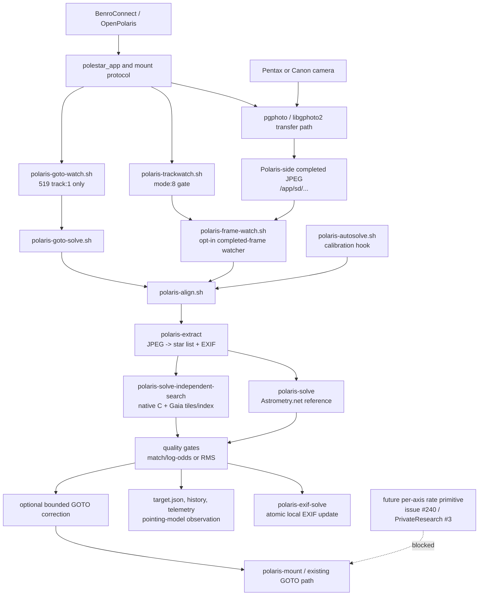

# Polaris Astro plate-solving

**Review date:** 2026-10-28
**Implementation branch:** [`feature/astro-native-platesolve`](https://github.com/ian-morgan99/benro-polaris-firmware-patcher/tree/feature/astro-native-platesolve)
**Current source checkpoint:** `5912176`

This is the concise product README for the Astro work. It explains what is
implemented, what is actually wired together, what has only been tested on a
host, and what is still required before this can be operated on a Polaris.
The longer design and evidence documents remain linked at the end.

## Executive verdict

The project is a **buildable, guarded Astro research implementation**, not a
field-ready unattended tracking product.

The source, native ARM bundle, two-solver host harness, Gaia catalogue package,
EXIF writer, mode gates, GOTO hooks, completed-JPEG watcher and safety tests are
in place. The available evidence reaches `ARM-BUILT` and host/QEMU smoke
qualification.

It does **not** yet reach device-offline qualification, camera-capture-path
qualification, physical pointing qualification, or motor-rate qualification.
No physical Polaris has yet demonstrated the complete sequence:

```text
BenroConnect calibration -> GOTO -> local JPEG -> solve -> EXIF -> drift
measurement -> safe correction -> tracking-rate adjustment
```

Astrometry.net remains the production/reference solver. The independent native-C
solver is installed beside it for controlled research comparison; it is not the
default and must not yet be selected for unattended operation.

## What the system is intended to do

The target journey is:

1. Start the Polaris and let BenroConnect autolevel it.
2. Attach the camera and select Astro mode.
3. Let the operator use the camera's StarAF/focus workflow.
4. Solve calibration and, optionally, each BenroConnect GOTO.
5. Record the solved target and use repeated GOTO residuals to improve the
   session's pointing estimate.
6. Admit each completed JPEG that is actually present on the Polaris.
7. Solve it using EXIF focal length and camera geometry, with the mount's RA/Dec
   as a search accelerator.
8. Fall back to a bounded indexed search when the hint is absent or fails.
9. Write the accepted result into the Polaris-side JPEG's EXIF and record the
   result in history/telemetry.
10. Measure positional drift and field rotation. Apply only bounded positional
    correction when explicitly enabled.
11. Eventually adjust independent motor rates, once the separate firmware
    command has been discovered and physically qualified.

The current implementation reaches the measurement and guarded-hook stages.
It does not yet close the physical capture, mount-control, or tracking-rate
stages.

No Astro-specific libgphoto2 change was required. The Astro layer consumes the
existing camera transfer/publication path and deliberately treats a JPEG as
eligible only after it exists on Polaris storage.

## Architecture



### Runtime components

| Component | Role | Current truth |
|---|---|---|
| `polaris-astro-boot.sh` | Starts the optional Astro daemons after the SD card is mounted | Source wired; post-boot operation on a real target is unverified |
| `polaris-trackwatch.sh` | Maintains the current mount mode/alignment state | Mode-8 gating is implemented; target-firmware trace still required |
| `polaris-align.sh` | One image in, one solved sky position out | Host-tested and packaged for ARM; physical camera path unverified |
| `polaris-extract` | Native C JPEG star extraction and EXIF focal parsing | ARM-built; QEMU smoke passed |
| `polaris-solve` | Astrometry.net-based reference solver | Default path; same-frame host solves passed |
| `polaris-solve-independent-search` | Native C Gaia tile/triangle-index search | Host and ARM-built; rendered Gaia corpus passed; not device-qualified |
| `polaris-autosolve.sh` | Calibration/live-view solve hook | Source wired, dry-run by default when enabled; exact BenroConnect trace and hardware run remain open |
| `polaris-goto-watch.sh` | Watches BenroConnect `519 track:1` GOTO completion | Calibration `track:0` is ignored; target-firmware field/order validation remains open |
| `polaris-goto-solve.sh` | Solves after a direct or watched GOTO and records target/model data | Source wired; apply gates are off by default; no physical GOTO evidence |
| `polaris-frame-watch.sh` | Solves stable, new Polaris-side JPEGs during mode 8 | Admission, deduplication, telemetry and EXIF path are tested; capture publication is unverified on target hardware |
| `polaris-exif-solve` | Adds owned solve JSON to local JPEG EXIF via a temporary file and rename | Host/QEMU write-back smoke passed; camera-card write-back is intentionally not performed |
| `polaris-mount` | Existing mount queries, GOTO and alignment protocol | Used by guarded hooks; no qualified rate-control command exists |

## What is wired, and what is not

The following table is the honest boundary between source wiring and product
operation. “Wired” means that a source path exists and its local contracts are
tested; it does not mean that the exact Benro firmware and camera have passed.

| Mission step | Source wiring | Default state | Qualification status |
|---|---|---|---|
| Start, autolevel, attach camera, StarAF | Existing BenroConnect/camera path is left intact | Existing behaviour | Not changed by this project; Astro-specific end-to-end run not performed |
| Enter Astro mode | Track watcher records and gates on `mode:8` | Gate active for new daemons | Host logic tested; exact firmware trace still required |
| Calibration solve | `polaris-autosolve.sh` and `polaris-align.sh` | `AUTOSOLVE` must be configured; dry-run is the safe starting point | Source/host evidence; no physical calibration pass |
| GOTO solve | Direct web path plus optional `519 track:1` watcher | `GOTO_PLATESOLVE=0`, `GOTO_SOLVE_WATCH=0` | Source/host evidence; no physical post-slew solve |
| Repeated GOTO refinement | `target.json`, history and session pointing model | Model records observations; `GOTO_MODEL_APPLY=0` | No physical accuracy improvement demonstrated |
| Completed JPEG admission | Stable size/JPEG-end-marker, mode gate, session boundary and path/size/mtime deduplication | `AUTO_SOLVE_FRAMES=0` | Host tests pass; local publication from the target camera remains unproven |
| Solve each local JPEG | EXIF focal first, camera sensor profile, RA/Dec hint, bounded fallback | Astrometry.net via `SOLVER_BIN=polaris-solve` | Host and ARM smoke; no real camera/device solve |
| Local EXIF result | Atomic local replacement and validation | Enabled by the solve path | Host/QEMU tested; no device round-trip |
| Drift/rotation measurement | Frame watcher writes JSONL action telemetry | Measurement only | Host logic tested; no physical drift session |
| Positional correction | Bounded existing GOTO can be selected | `FRAME_CORRECT=0` | Not physically qualified |
| Motor-speed adjustment | No live per-axis rate command is connected | Unavailable; telemetry says `rate_control:unavailable` | Blocked on issue [#240](https://github.com/ian-morgan99/benro-polaris-firmware-patcher/issues/240) / PrivateResearch Issue #3 |
| Continuous unattended tracking | No complete closed loop | Not enabled | Not ready |

## Solver and catalogue approach

### Reference path: Astrometry.net

`polaris-solve` uses the existing Astrometry.net-derived path and FITS indexes.
It is the default because it has the more mature blind-search behaviour and is
the reference against which the native path is being evaluated.

### Independent path: native C and Gaia

The native path is entirely C on the device route:

```text
JPEG -> native star extraction -> Gaia tile selection -> triangle-ratio index
     -> bounded RA/Dec hint/corkscrew attempts -> match/RMS gates -> JSON result
```

The package contains Gaia DR3-derived tiles and a compact triangle-ratio index.
The RA/Dec hint is used first because it is fast. A stale or failed hint falls
back to the bounded indexed search. A focal length is still required for the
scale gate; EXIF is preferred, camera-model sensor width supplies APS-C/full-
frame geometry, and explicit configuration is the fallback.

The native path has solved a five-scene rendered Gaia corpus without a hint and
has passed an APS-C hinted rendered solve. The compact blind-search index does
not yet guarantee the same narrow-field APS-C coverage; this is tracked in
issue [#248](https://github.com/ian-morgan99/benro-polaris-firmware-patcher/issues/248).

### Comparison results so far

The results are useful but not enough to select the native solver:

- On the paired synthetic host smoke, Astrometry.net took about 0.023 s and
  native C about 0.03 s. The native catalogue was derived from the rendered
  observation, so its exact result is not independent accuracy evidence.
- On the real-Gaia rendered regional comparison, Astrometry.net took about
  0.02 s and native C about 3.79 s. Both solved the field; this was one host
  frame and not a device benchmark.
- The native real-Gaia result was approximately 13.4 arcsec from rendered
  truth with about -0.0223% scale error. That is encouraging research evidence,
  not a camera accuracy guarantee.

The conclusion remains: **Astrometry.net is faster and remains the default;
native C is a promising, smaller, independent alternative that still needs
real-camera, false-solve, ARM-resource and device evidence.**

## Safety and K-3 III protection

The new path is deliberately additive and opt-in:

- normal K-3 III capture, StarAF and libgphoto2 ownership are not changed;
- no watcher fires the camera shutter;
- only files already published on Polaris storage are considered;
- camera-card originals are never rewritten;
- mode 8 is required for completed-frame automation;
- calibration and GOTO corrections are separately gated;
- model application, heading correction, frame correction and guiding are off
  by default;
- excessive drift, high rotation, weak matches, stale files and failed solves
  fail closed;
- no motor-rate command is currently emitted.

This makes the source suitable for controlled bench work. It does not make an
unqualified firmware installation safe to use unattended.

## Build and deployment policy

The Astro feature branch is **build-only by default**:

```sh
./scripts/build-astro-bundle.sh \
  --id astro-test-001 \
  --catalog-package out/gaia-dr3-g10
```

The script requires the feature branch and a clean tree, runs the focused test
and shell gates, builds the ARM bundle, records a SHA-256 SD-tree manifest and
source provenance, and writes only under `out/`. It does not upload, install,
modify a device, build FwPkt, or flash firmware. Use `--no-indexes` for a fast
bundle smoke when the Gaia package is already available.

The main-branch `scripts/build-release-candidate.sh` has a separate release-side
publication/deployment contract. Do not substitute it for this Astro build.

The most recent local build proved:

- 40 focused Astro tests passed;
- native ARM binaries and corresponding GPL source were packaged;
- QEMU ARM extraction and EXIF write-back smoke passed;
- provenance recorded `deployment=not-performed`.

The output under `out/` is intentionally ignored and is not itself a release
or deployment record.

## Readiness ladder

| Gate | Meaning | Status |
|---|---|---|
| `SOURCE-BUILT` | Native C sources, scripts and licence boundary are present | **PASS** |
| `HOST-PAIRED` | Both solvers process the same host observation | **PASS** |
| `REAL-GAIA-RENDERED` | Native indexed search works against downloaded Gaia data | **PASS, limited corpus** |
| `FALSE-SOLVE-TESTED` | Weak/wrong candidates are rejected | **PASS, host cases** |
| `ARM-BUILT` | Device ABI, dependency and licence guards pass | **PASS** |
| `QEMU/OFFLINE-SMOKE` | ARM usage and EXIF write-back smoke pass | **PASS** |
| `DEVICE-OFFLINE-QUALIFIED` | Installed on the exact Polaris and identity verified | **NOT DONE** |
| `CAPTURE-PATH-QUALIFIED` | Camera capture reliably publishes the expected local JPEG | **NOT DONE** |
| `EXIF-QUALIFIED` | Device EXIF update/readback/recovery is proven | **NOT DONE** |
| `POINTING-QUALIFIED` | Calibration, GOTO and repeated solves improve real pointing | **NOT DONE** |
| `RATE-CONTROL-QUALIFIED` | Firmware-backed rate changes are safe and physically tested | **NOT DONE** |

## Work still required

In priority order:

1. **Trace the real capture boundary.** On the exact target firmware and
   supported Pentax body, prove where a completed Astro JPEG appears on Polaris,
   what metadata survives transfer, and how recovery behaves after a failed or
   interrupted capture.
2. **Install offline, safely.** Use the sanctioned SD/install path, verify
   post-boot provenance and run only read-only/dry-run probes first.
3. **Run one physical calibration and GOTO.** Capture the BenroConnect `519`,
   `530` and related records, confirm ordering/duplicates, and prove one
   post-slew solve without applying correction.
4. **Run repeated physical GOTO solves.** Check target records, residual model
   behaviour, stale/wrong hints and rejected low-confidence frames. Keep model
   application disabled until this evidence is reviewed.
5. **Run completed-frame sessions.** Prove local JPEG admission, two-solver
   selection, EXIF preservation/readback, duplicate suppression, drift and
   rotation telemetry, and recovery across multiple images.
6. **Close the native index decision.** Expand the APS-C/narrow-field corpus or
   change the index under measured SD/RAM/time limits; do not enlarge it just to
   make one case pass.
7. **Resolve motor-rate control.** Complete issue #240 / PrivateResearch Issue
   #3: exact command, units, signs, acknowledgements, watchdog, stop priority,
     fault injection and hardware qualification. Jog/deadman messages are not a
   substitute for tracking-rate control.
8. **Protect the existing camera path.** Repeat the K-3 III regression matrix
   after any integration change; no Astro result is a reason to weaken normal
   capture or camera recovery.

## Evidence and detailed documents

- [End-to-end mission readiness](ASTRO-MISSION-READINESS.md)
- [Full Astro design and operator notes](ASTRO.md)
- [Plate-solving master plan](PLATE-SOLVING-MASTER-PLAN.md)
- [Capture, storage and EXIF safety contract](PLATE-SOLVE-CAPTURE-FLOW.md)
- [Dual-solver operation](DUAL-SOLVER.md)
- [Native solver usability audit](INDEPENDENT-SOLVER-USABILITY-AUDIT.md)
- [Licence audit](LICENSE-AUDIT.md)
- [Real Gaia comparison](evidence/dual-solver-gaia-20261028/SUMMARY.md)
- [Native indexed-search evidence](evidence/native-search-20261028/SUMMARY.md)
- [Native ARM bundle evidence](evidence/native-arm-bundle-20261028/SUMMARY.md)
- [Dual-solver host evidence](evidence/dual-solver-overnight-20261028/SUMMARY.md)

The controlling conclusion is unchanged: this is ready for reproducible build,
host comparison and carefully staged bench work. It is not yet ready to operate
as the requested autonomous Polaris tracking product.
